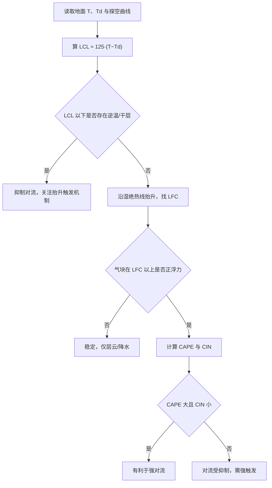

拿到一张探空曲线，最先要回答的问题不是「会不会下雨」，而是「这层空气被抬起来之后会怎样」。稳定度分析就是回答这个问题。

## 三把尺子：环境递减率、干绝热、湿绝热

环境温度随高度的变化率定义为

$$
\gamma=-\frac{\partial T}{\partial z}
$$

气块绝热上升时的温度变化则由热力学第一定律给出：

$$
\Gamma_d=\frac{g}{c_p}\approx 9.8\ \text{K·km}^{-1}
$$

未饱和气块按 $\Gamma_d$ 降温；一旦饱和，凝结潜热释放使降温变慢，得到湿绝热递减率 $\Gamma_m$，在暖湿低层约为 4–6 K/km，高层接近 $\Gamma_d$。

把两者与环境递减率比较，就得到稳定度判据：

| 条件                       | 稳定度       | 直观含义                     |
| -------------------------- | ------------ | ---------------------------- |
| $\gamma<\Gamma_d$          | 绝对稳定     | 抬升后气块比环境冷，会往回掉 |
| $\gamma=\Gamma_d$          | 中性         | 抬到哪就停在哪               |
| $\Gamma_d<\gamma<\Gamma_m$ | 条件性不稳定 | 未饱和时稳定，饱和后不稳定   |
| $\gamma>\Gamma_m$          | 绝对不稳定   | 一抬就加速上升               |

中纬度大部分降水天气对应的都是**条件性不稳定**：低层暖湿、中层有干层，一旦触发对流，潜热释放会让气块加速。

## 位温：把气团搬到同一高度比较

$$
\theta=T\left(\frac{p_0}{p}\right)^{R/c_p},
\qquad \frac{R}{c_p}\approx 0.286
$$

位温的作用是把不同气压上的温度折算到 1000 hPa，从而判断两团空气是否同源。位温随高度迅速减小（$\partial\theta/\partial z<0$）是条件性不稳定的强信号；而位温随高度增加则说明层结稳定。

对应的湿等效位温

$$
\theta_e\approx\theta\exp\left(\frac{L_v q}{c_p T}\right)
$$

在饱和过程中近似守恒，是追踪气团、判断对流潜力的常用量。

## 抬升凝结高度

未饱和气块被抬升到相对湿度 100% 的高度就是 LCL。用地面温度与露点温度可以快速估算（Espy 关系）：

$$
z_{LCL}\approx 125\left(T-T_d\right)\ \text{m}
$$

其中 $T$、$T_d$ 取摄氏度。这个经验式在边界层内相当准，误差通常在几十米量级；抬升凝结高度以上再抬升，气块就进入湿绝热过程。

更高层次还有两个关键高度：

- **自由对流高度（LFC）**：气块温度首次高于环境温度的高度，从此开始正浮力；
- **平衡高度（EL）**：浮力重新变为零的高度，通常接近对流层顶。

## 判断流程

## CAPE 与 CIN

对流有效位能是对浮力沿高度的积分：

$$
\text{CAPE}=\int_{LFC}^{EL} R_d\left(T_{v,p}-T_{v,e}\right)\,d\ln p
$$

其中 $T_{v,p}$、$T_{v,e}$ 分别是气块与环境的虚温。对应的对流抑制能 CIN 则是 LFC 以下负浮力区的积分。经验上：

- CAPE 1000–2500 J/kg：中等对流潜力；
- CAPE > 2500 J/kg 且 CIN 很小：强对流的环境背景；
- CAPE 很大但 CIN 也很大：需要锋面、地形或边界层辐合提供触发。

> 探空不是判决书。同样的 CAPE，配上不同的风切变，得到的可能是孤立雷暴，也可能是组织化的超级单体。
