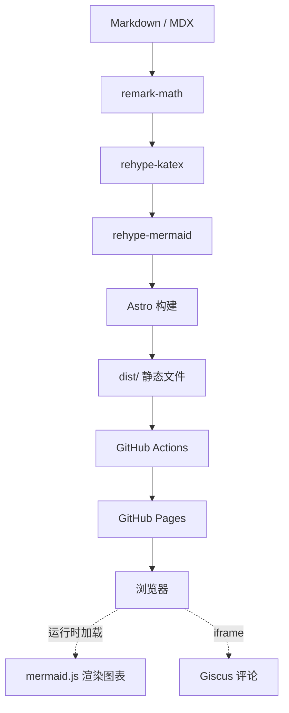

把博客当成一个持续维护的工程来做，比当成一次性消费品要省心得多。这篇文章记录这套站点是怎么拼起来的，顺便当作使用说明。

## 整体结构

整站是纯静态的：构建时把 Markdown 编译成 HTML，部署到 GitHub Pages 的静态托管上；唯一需要服务端的部分是评论，交给 Giscus 借 GitHub Discussions 完成。



关键取舍是：**公式在构建期渲染、图表在浏览器里渲染**。KaTeX 是纯函数式的排版，构建期做完最省事；Mermaid 需要测量文字尺寸，交给浏览器更稳，也不必在 CI 里跑一个无头浏览器。

## 目录结构

```text
.
├── astro-paper.config.ts        # 站点标题、作者、社交链接等
├── astro.config.ts              # Markdown 插件链、i18n、base 路径
├── src
│   ├── content
│   │   ├── posts                # 文章，按栏目分目录
│   │   └── pages/about.md       # 「关于」页
│   ├── data
│   │   ├── categories.ts        # 栏目定义（分类页与文章卡片的来源）
│   │   └── giscus.ts            # 评论配置
│   ├── custom                   # 主题不会覆盖的自定义文件
│   │   ├── Head.astro           # 引入 KaTeX 样式与自定义 CSS
│   │   ├── BodyEnd.astro        # 挂载 Mermaid 渲染器
│   │   └── PostEnd.astro        # 评论区
│   ├── pages/categories         # 分类总览与分页
│   └── styles/custom.css        # 公式 / 图表 / 评论的样式
└── .github/workflows/deploy.yml # 构建并发布到 Pages
```

## 写一篇新文章

在 `src/content/posts/<栏目>/` 下新建 `.md`，frontmatter 至少要有这些字段：

```yaml
---
title: "标题"
pubDatetime: 2026-11-25T10:00:00+08:00
category: 电力电子 # 必须是 src/data/categories.ts 里的 name
description: "一句话摘要，会出现在列表和搜索结果里"
tags: ["buck", "control"]
---
```

`category` 写错会在 `astro check` 阶段直接报错，不会出现「文章悄悄消失」的情况。

## 公式与图表

行内公式用单个美元符，独立公式用双美元符：

```markdown
能量守恒：$E = mc^2$

$$
\eta = \frac{W_{net}}{Q_{in}}
$$
```

图表用 `mermaid` 代码块，支持 flowchart / sequence / class 等 Mermaid 的语法：

````markdown

````

## 开启评论

Giscus 的前提条件有三条：仓库公开、打开 Discussions、安装 [Giscus App](https://github.com/apps/giscus)。之后到 [giscus.app](https://giscus.app/zh-CN) 选好仓库与分类，把生成的两个 ID 填进 `src/data/giscus.ts`：

```ts
export const giscusSettings: GiscusSettings = {
  repo: "your-name/blog",
  repoId: "R_kgDO...", // giscus.app 生成
  category: "Announcements",
  categoryId: "DIC_kwDO...", // giscus.app 生成
  // ...
};
```

也可以不改代码，改在构建时注入环境变量：`PUBLIC_GISCUS_REPO`、`PUBLIC_GISCUS_REPO_ID`、`PUBLIC_GISCUS_CATEGORY_ID`。仓库的 Actions 里已经预留了从 Repository variables 读取的位置。

## 部署到 GitHub Pages

`.github/workflows/deploy.yml` 会在每次推送到 `main` 时自动构建并部署。它还会根据仓库名推算路径：

| 仓库类型            | 访问地址                         | 构建时的 base |
| ------------------- | -------------------------------- | ------------- |
| `<user>.github.io`  | `https://<user>.github.io/`      | `/`           |
| 任意项目仓库 `blog` | `https://<user>.github.io/blog/` | `/blog`       |

首次部署后，记得在仓库 **Settings → Pages → Build and deployment** 里把 Source 设为 **GitHub Actions**。

本地预览：

```bash
pnpm install
pnpm dev        # 开发服务器
pnpm build      # 构建到 dist/，同时生成 Pagefind 搜索索引
pnpm preview    # 预览构建结果
```

## 剩下的坑

- **Node 版本**：主题要求 Node ≥ 22.23.4，Actions 里用的是 24。
- **base 路径**：项目仓库部署在子路径下，本地若要复现，需要 `BASE_PATH=/blog pnpm build`。
- **中文字体**：正文用系统字体栈，避免为几 MB 的中文字体文件付出加载代价；OG 图因此改成了静态图片。

> 这套结构的最大好处是「文章即数据」：改一个 `category`，导航、分类页、文章卡片会一起更新，不需要手动维护任何列表。
