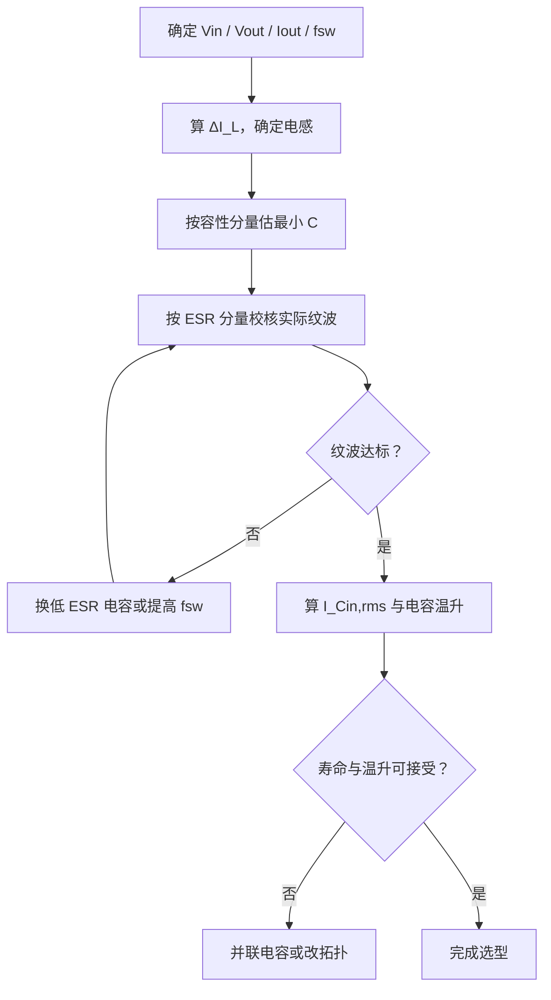

开关电源的纹波不是「一个数」，而是几个来源叠加的结果。把每一项单独算清楚，选型时才知道余量该留多少。

## 电感电流纹波

CCM 下电感电流的峰峰值由伏秒平衡直接给出：

$$
\Delta I_L=\frac{V_{out}\left(1-D\right)}{L f_{sw}},
\qquad D=\frac{V_{out}}{V_{in}}
$$

代入 $V_{out}=D V_{in}$ 还可以写成

$$
\Delta I_L=\frac{V_{in}D\left(1-D\right)}{L f_{sw}}
$$

这个式子在 $D=0.5$ 时取最大值，所以宽输入范围的设计要按最坏点校核，而不是按标称输入。

## 输出纹波的两个分量

电感纹波电流几乎全部流进输出电容，于是输出电压纹波是

$$
\Delta V_{out}\approx
\underbrace{\frac{\Delta I_L}{8 C f_{sw}}}_{\text{容性分量}}
+\underbrace{\Delta I_L\, r_c}_{\text{ESR 分量}}
$$

两项的量级差异很大。以 $C=100$ µF、$r_c=10$ mΩ、$\Delta I_L=0.5$ A、$f_{sw}=500$ kHz 为例：

- 容性分量：约 1.25 mV；
- ESR 分量：约 5 mV。

也就是说，**在这种参数下纹波主要由 ESR 决定**，把电容从 100 µF 加到 200 µF 几乎没有收益，换低 ESR 的电容才有效。这也是为什么很多设计最后选了陶瓷电容：容值不大，但 ESR 极低。

## 输入电容的有效值电流

输入电容承受的是脉冲电流，其有效值为

$$
I_{C_{in},rms}=I_{out}\sqrt{D\left(1-D\right)}
$$

同样在 $D=0.5$ 时最大，等于 $0.5 I_{out}$。这个值决定电容的发热与寿命，往往比容值更难满足。

## 选型流程



## 一个容易忽略的细节

陶瓷电容的容值会随直流偏压大幅下降。标称 22 µF / 25 V 的 X5R，在 12 V 偏压下可能只剩 8–10 µF。所以按公式算完最小容值之后，还要查厂家提供的偏压曲线，或者干脆按 −50% 的降额来设计。

```python
def buck_ripple(vin, vout, iout, L, C, rc, fsw):
    d = vout / vin
    di = vout * (1 - d) / (L * fsw)
    v_cap = di / (8 * C * fsw)
    v_esr = di * rc
    i_cin = iout * (d * (1 - d)) ** 0.5
    return di, v_cap, v_esr, i_cin

di, v_cap, v_esr, i_cin = buck_ripple(12, 5, 1.0, 10e-6, 100e-6, 0.01, 500e3)
print(f"ΔI_L = {di*1e3:.0f} mA")
print(f"容性纹波 = {v_cap*1e3:.2f} mV, ESR 纹波 = {v_esr*1e3:.2f} mV")
print(f"输入电容有效值电流 = {i_cin*1e3:.0f} mA")
```

> 结论：纹波预算要分项列出，才知道钱该花在容值、ESR 还是开关频率上。
