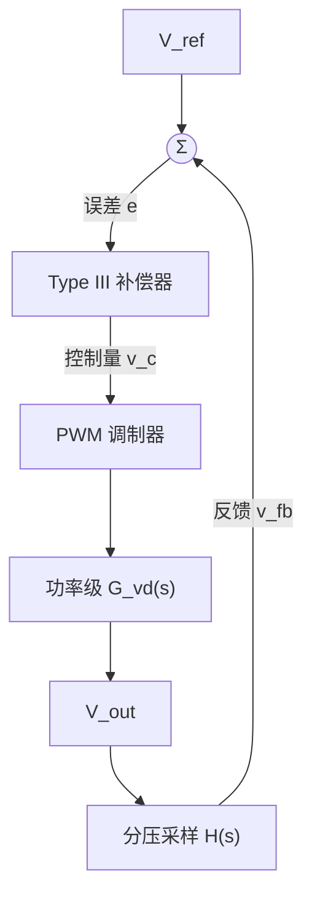
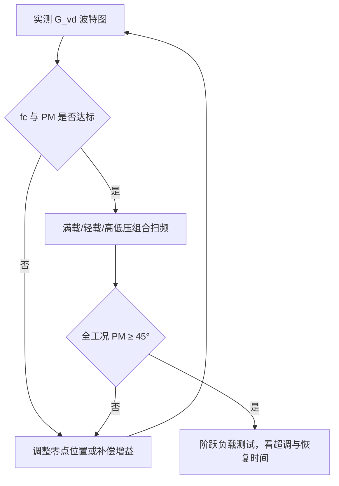

做电源最怕的不是算不对，而是算完不知道对不对。小信号模型的价值在于：它把「究竟稳不稳」变成了一个可以画出来、可以量出来的问题。

## 从平均模型到传递函数

Buck 在 CCM 下，一个开关周期内电感电压的平均值为

$$
\langle v_L \rangle = D\,v_g - v
$$

对电感方程 $\frac{di_L}{dt}=\frac{\langle v_L\rangle}{L}$ 和电容方程 $C\frac{dv}{dt}=i_L-\frac{v}{R}$ 做线性化，得到控制到输出的传递函数（忽略 ESR）：

$$
G_{vd}(s)=\frac{\hat{v}(s)}{\hat{d}(s)}=\frac{V_g}{1+\dfrac{s}{Q\omega_0}+\left(\dfrac{s}{\omega_0}\right)^2}
$$

其中

$$
\omega_0=\frac{1}{\sqrt{LC}},\qquad Q=R\sqrt{\frac{C}{L}}
$$

这个式子已经包含了所有重要信息：

- 直流增益等于 $V_g$，所以输入电压越高，占空比扰动带来的输出扰动越大；
- 转折频率 $\omega_0$ 处有 −180° 的相位下滑，Q 越大下滑越陡；
- 负载越轻（$R$ 越大），Q 越大，谐振峰越尖——轻载时最容易振荡。

考虑输出电容的等效串联电阻 $r_c$ 之后，高频处会多出一个零点：

$$
\omega_z=\frac{1}{r_c C}
$$

它把相位往回拉，通常对稳定性是好事，但也让高频增益不再以 −40 dB/dec 衰减。

## 设计目标怎么定

工程上常用的两个约束：

1. **穿越频率** $f_c \le \frac{1}{10} f_{sw}$，给开关纹波和采样延迟留余量；
2. **相位裕度** 45°–60°，兼顾响应速度与超调。

如果功率级在 $f_c$ 处的相位是 $\varphi_p$，那么补偿器需要提供的相位提升为

$$
\varphi_{boost}=\text{PM}-\varphi_p-90^\circ
$$

（$90^\circ$ 来自补偿器的积分环节。）

## Type III 补偿器

Type III 的传递函数可以写成

$$
G_c(s)=-\frac{\omega_{p0}}{s}\cdot
\frac{\left(1+\dfrac{s}{\omega_{z1}}\right)\left(1+\dfrac{s}{\omega_{z2}}\right)}
{\left(1+\dfrac{s}{\omega_{p1}}\right)\left(1+\dfrac{s}{\omega_{p2}}\right)}
$$

工程实践里的放置规则很朴素：

| 元件                     | 放置位置                                | 目的                       |
| ------------------------ | --------------------------------------- | -------------------------- |
| 两个零点 $f_{z1},f_{z2}$ | 跨在 $f_0$ 两侧，例如 $f_0/2$ 与 $2f_0$ | 抵消 LC 双极点的相位下滑   |
| 第一个极点 $f_{p1}$      | 放在 ESR 零点附近                       | 压掉高频增益与噪声         |
| 第二个极点 $f_{p2}$      | $f_{sw}/2$ 附近                         | 抑制开关纹波进入误差放大器 |

一个 12 V→5 V、$f_{sw}=500$ kHz 的例子，参数与计算结果：

| 参数               | 数值           |
| ------------------ | -------------- |
| $L$ / $C$          | 10 µH / 100 µF |
| 负载 $R$           | 5 Ω（1 A）     |
| LC 转折频率 $f_0$  | 约 5.0 kHz     |
| 品质因数 $Q$       | 约 15.8        |
| 目标穿越频率 $f_c$ | 50 kHz         |

Q 接近 16，意味着谐振峰的幅值约 24 dB——如果不补偿，这个峰几乎必然把环路推到不稳定。

```python
import math

vin, vout = 12.0, 5.0
L, C, R = 10e-6, 100e-6, 5.0
fsw = 500e3

w0 = 1 / math.sqrt(L * C)
f0 = w0 / (2 * math.pi)
Q = R * math.sqrt(C / L)

fc = fsw / 10                      # 目标穿越频率
fz1, fz2 = f0 / 2, 2 * f0          # 两个零点跨在 LC 双极点两侧
fp1 = 1 / (2 * math.pi * 0.01 * C)  # ESR ＝ 10 mΩ
fp2 = fsw / 2

print(f"f0 = {f0/1e3:.1f} kHz, Q = {Q:.1f}")
print(f"fc = {fc/1e3:.0f} kHz, fz = {fz1/1e3:.1f}/{fz2/1e3:.1f} kHz")
print(f"fp1 = {fp1/1e3:.0f} kHz (ESR), fp2 = {fp2/1e3:.0f} kHz")
```

## 环路长什么样

把功率级、调制器、采样网络和补偿器连接起来，就是一张标准的电压模式控制框图：



调试时我一般按这个顺序走：



## 几个容易踩的坑

- **只算标称工况**：轻载时 $Q$ 变大，穿越频率也会上移，最好把轻载当作最坏情况来校核。
- **忽略采样延迟**：数字控制里还有约 1.5 个开关周期的延迟，$f_c$ 越高，这部分相位损失越致命。
- **补偿器增益与占空比限幅**：算出来的增益在启动或短路时会让误差放大器饱和，记得加抗积分饱和。

> 公式只是起点。真正让环路可靠的，是在满载、轻载、最低/最高输入电压这些角点上各扫一次频。
