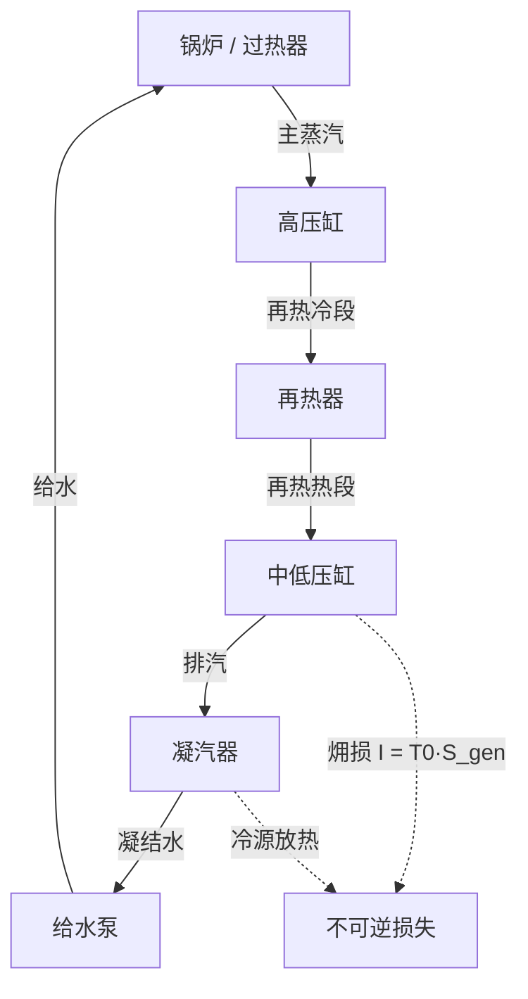

热效率是结果，㶲分析是诊断。两者配合，才能判断一台机组还有多少改进空间。

## 循环的热效率

以带回热的再热朗肯循环为例，各段功量与热量都能用状态点焓值表示：

$$
w_T=\left(h_1-h_2\right)+\left(h_3-h_2\right),\qquad
w_P\approx v\left(p_1-p_2\right)
$$

$$
q_{in}=\left(h_1-h_5\right)+\left(h_3-h_2\right)
$$

$$
\eta_{th}=\frac{w_T-w_P}{q_{in}}
$$

其中下标 1 为主蒸汽、2 为高压缸排汽、3 为再热后蒸汽、5 为给水。循环效率的上限由热源与冷源温度决定：

$$
\eta_{Carnot}=1-\frac{T_L}{T_H}
$$

实际循环永远低于它，差距主要来自**有限温差传热**和**不可逆膨胀**。

## 一组示意的状态点

取 16.7 MPa / 538 °C 主蒸汽、再热至 538 °C、凝汽压力 5 kPa，汽轮机相对内效率取 0.88，得到一组建模用的状态点（数值按 IAPWS-IF97 查表，此处保留一位小数）：

| 状态点 | 位置       | $p$ / MPa | $T$ / °C | $h$ / kJ·kg⁻¹ | $s$ / kJ·kg⁻¹·K⁻¹ |
| ------ | ---------- | --------- | -------- | ------------- | ----------------- |
| 1      | 主蒸汽     | 16.7      | 538      | 3396.0        | 6.42              |
| 2      | 高压缸排汽 | 3.5       | 约 280   | 2900.0        | 6.42              |
| 3      | 再热后     | 3.5       | 538      | 3530.0        | 7.10              |
| 4      | 低压缸排汽 | 0.005     | 32.9     | 2328.0        | 7.62              |
| 5      | 给水       | 16.7      | 约 35    | 154.5         | 0.50              |

按上表代入：$w_T\approx1698$ kJ/kg，$w_P\approx16.7$ kJ/kg，$q_{in}\approx3871$ kJ/kg，于是

$$
\eta_{th}\approx\frac{1698-16.7}{3871}\approx 43.5\%
$$

比同温限的卡诺循环（$T_H\approx811$ K、$T_L\approx306$ K，约 62%）低近 20 个百分点。这 20 个百分点里，很大一部分是锅炉侧有限温差传热造成的——而这一项，热效率本身是看不出来的。

## 用㶲把损失拆开

比㶲的定义是

$$
e=\left(h-h_0\right)-T_0\left(s-s_0\right)
$$

对于稳定流动的部件，㶲平衡可以写成

$$
\dot{E}_{in}-\dot{E}_{out}=\dot{W}+\dot{I},\qquad
\dot{I}=T_0\dot{S}_{gen}
$$

$\dot{I}$ 就是**㶲损**，即不可逆性造成的做功能力损失。以 $T_0=298.15$ K 计算，上面这组状态点的关键结果：

| 项目         | 数值 / kJ·kg⁻¹ | 说明                 |
| ------------ | -------------- | -------------------- |
| 锅炉侧输入㶲 | 约 1470        | 主蒸汽与给水的比㶲差 |
| 再热输入㶲   | 约 427         | 再热段吸热的㶲值     |
| 净功         | 约 1681        | $w_T-w_P$            |
| 循环㶲效率   | 约 89%         | 净功 / 输入㶲        |

也就是说，**循环内部的不可逆损失只占约 11%**，而整个电站的㶲效率通常只有 55%–60%：最大的损失发生在燃烧与传热环节，温度越高的地方越值钱。

## 改进方向与代价

| 措施             | 热效率   | 㶲效率   | 代价               |
| ---------------- | -------- | -------- | ------------------ |
| 提高主蒸汽参数   | 明显提升 | 提升有限 | 材料等级、造价     |
| 降低凝汽压力     | 提升     | 提升     | 冷端面积、真空系统 |
| 增加回热级数     | 提升     | 提升     | 系统复杂度         |
| 提高汽轮机内效率 | 提升     | 明显提升 | 通流设计、制造精度 |

> 经验上，主蒸汽温度每提高 10 K，循环效率约提高 0.2–0.3 个百分点；而冷端每改善 1 kPa，收益往往更便宜。做方案比较时，㶲损的分布比效率的绝对值更有指导意义。
